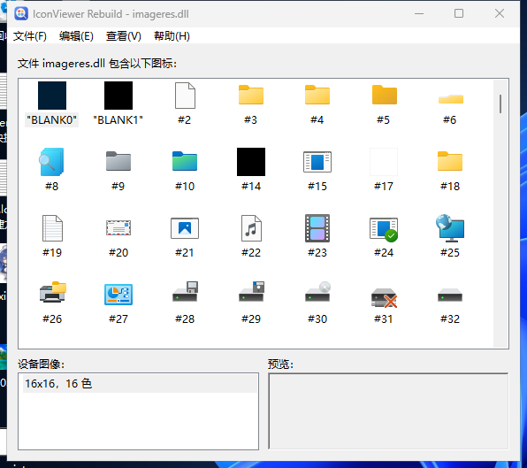
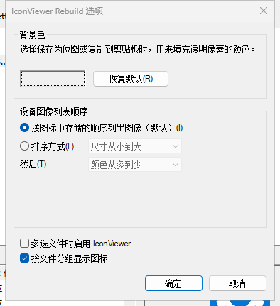

# IconViewer Rebuild

<p align="center"></p>

<p align="center">
  <a href="../../releases"></a>
  <a href="LICENSE"></a>
  
  
</p>

A small portable Windows tool that shows **every icon and device image inside a program,
library or icon file** — a from-scratch Win32 reimplementation of the classic
[IconViewer 3.02](https://www.botproductions.com/iconview/iconview.html) Explorer property
page, rebuilt as a standalone app.

No installation, no shell extension, no dependencies: one `IconViewerRebuild.exe`.

> Built with **DSH** + **DeepSeek-V4.1-Flash (1017)** — analysis, implementation, icon and
> docs were produced in that setup. See [CREDITS.md](CREDITS.md).


---

## Features

* **Look inside anything with icons** — `.exe`, `.dll`, `.ocx`, `.cpl`, `.scr`, `.ico`, `.cur`.
  Reads `RT_GROUP_ICON` resources plus stray `RT_ICON`s, and parses icon files directly
  (signature based, not extension based).
* **All device images** — every size and colour depth in an icon, labelled the way the
  original did: `256x256, 32-bit (PNG)`, `48x48, 256 colors`, …
* **Preview + magnifier flyout** — 1:1 preview; images that do not fit pop out anchored to
  the preview box.
* **Multi-select and drag out** — select many icons with Ctrl/Shift or Ctrl+A and drag them
  straight to Explorer or the desktop as real `.ico` files.
* **Copy that actually pastes** — puts `CF_HDROP` (files) *and* `CF_DIB`/`CF_BITMAP` on the
  clipboard, so Explorer pastes icon files while Paint/Word paste the bitmap.
* **Export** — write the selected icons (or all of them) to a folder in one go.
* **Save As** — whole icon → `.ico`, single device image → `.bmp` (background colour blended)
  or `.png` (alpha preserved).
* **Options** — background colour, device-image ordering (size / colour depth, asc / desc),
  multi-file behaviour, grouping by file.
* **English & 简体中文**, follows the system language and can be switched at runtime.
* **Long resource names** are ellipsised in the list and shown in full on hover.

## Download

Grab `IconViewerRebuild.exe` from the **[releases page](../../releases)** — x64, Windows 7 or
newer, single file, no runtime to install. Current version: **1.0.0**.

The exe is unsigned, so SmartScreen may ask once; there is no installer and nothing is
registered in Explorer.

## Screenshots

|  |  |
| --- | --- |
|  |  |
| Several files, grouped by file | Options: background colour and ordering |

## Usage

```
IconViewerRebuild.exe [files...]
```

* Open files with **File > Open** (Ctrl+O), by dragging them onto the window, or on the
  command line.
* Pick an icon to see its device images; pick an image to preview it.
* **Ctrl+A** select all, **Ctrl+C** copy, **Ctrl+S** save as, **F5** refresh, **F1** help.

| Action | How |
| --- | --- |
| Look at icons | open a file / drop it on the window |
| See a bigger preview | select a large image — the flyout follows the preview box |
| Copy files | Ctrl+C, then paste in Explorer |
| Copy a bitmap | Ctrl+C, then paste in Paint/Word |
| Drag icons out | drag a selection to the desktop or a folder |
| Export many | File > Export Icons… |
| Change look/order | View > Options… |
| Change language | View > Language |

## FAQ

**Why not a shell extension like the original?**
Because a portable exe is easier to keep working, needs no admin rights, cannot crash
Explorer, and works on files you cannot easily right-click (a DLL inside a package, a file on
a network share). Use *Open with…* if you want it from Explorer.

**Does it need administrator rights?** No. Settings go to
`HKCU\Software\IconViewerRebuild` and nothing else is written.

**Why does SmartScreen complain?** The exe is not code-signed. Build it yourself with
`build.bat` if you prefer, the result is byte-for-byte equivalent in behaviour.

**Some icons show as black squares.** Those resources really are black (or fully
transparent) 16×16 images — Windows shows the same thing. Use the device-image list to pick a
different size.

**Can I paste into Explorer?** Yes — Ctrl+C puts the icons on the clipboard as files
(`CF_HDROP`), so `Ctrl+V` in a folder writes `.ico` files.

**Does it support .ani, .icns, SVG?** Not today. `.ico`, `.cur` and PE resources only.

## Build

Requirements: Visual Studio 2022/2026 Build Tools (MSVC + Windows SDK).

```bat
build.bat
:: -> build\IconViewerRebuild.exe
```

or with CMake:

```bat
cmake -S . -B out -A x64
cmake --build out --config Release
:: -> out\Release\IconViewerRebuild.exe
```

Details, the console test harnesses and troubleshooting notes are in
[docs/BUILDING.md](docs/BUILDING.md).

## How it works

* `LoadLibraryExW(LOAD_LIBRARY_AS_DATAFILE | LOAD_LIBRARY_AS_IMAGE_RESOURCE)` +
  `EnumResourceNamesW(RT_GROUP_ICON)` for modules; `ICONDIR` parsing for `.ico`/`.cur`.
* Icon DIBs are decoded by hand (1/4/8/16/24/32 bpp, `BI_BITFIELDS`, the "all-zero alpha →
  AND mask" fallback, and the doubled `biHeight` of icon DIBs). PNG frames go through GDI+.
* List thumbnails are built by picking the frame closest to 32×32 with the highest colour
  depth, scaling it and calling `CreateIconIndirect`.
* Drag & drop uses a small `IDataObject`/`IDropSource` pair with `CF_HDROP` + `CF_DIB`.

More background on the original: [docs/analysis.md](docs/analysis.md).

## Relationship to the original IconViewer

This is an **independent reimplementation**, not a fork. No code, binaries, icons or help
files from the Bot Productions package are used or redistributed — the app icon is drawn by
`tools/icon`, the UI is rebuilt from scratch. "IconViewer" is used descriptively.
See [ATTRIBUTION.md](ATTRIBUTION.md).

## Layout

```
src/            C++ sources (common, strings, bitmap, icofile, dataobject, settings, preview, main)
res/            app.rc, manifest, generated app.ico
tools/icon/     icon renderer + ICO packer (PowerShell + Node)
tools/social/   repository social-preview generator
tests/          console harnesses for loading and saving
docs/           analysis notes, build guide, release notes, screenshots
```

## Regenerating the assets

```bat
powershell -File tools\icon\render-icon.ps1
node tools\icon\make-ico.js
powershell -File tools\social\make-social-preview.ps1
```

## License

MIT — see [LICENSE](LICENSE). Original IconViewer is © 2008 Bot Productions and is **not**
part of this project.

## Credits

Produced with **DSH** (DeepSeek Harness) driving **DeepSeek-V4.1-Flash (1017)**. Details in
[CREDITS.md](CREDITS.md).
